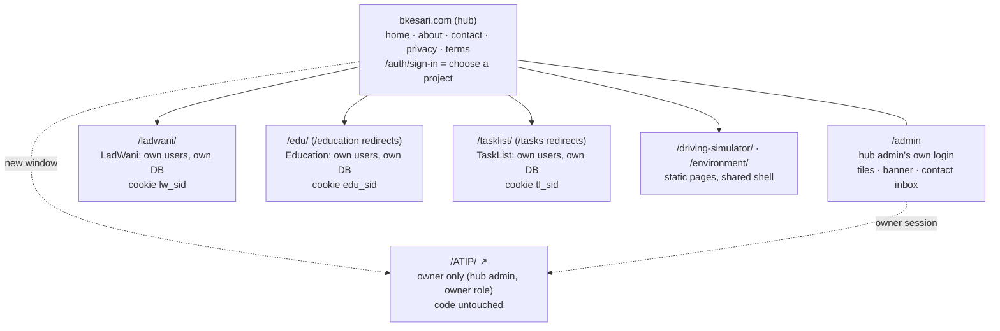
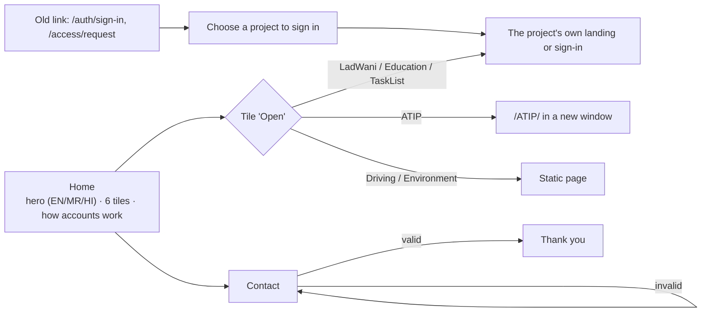
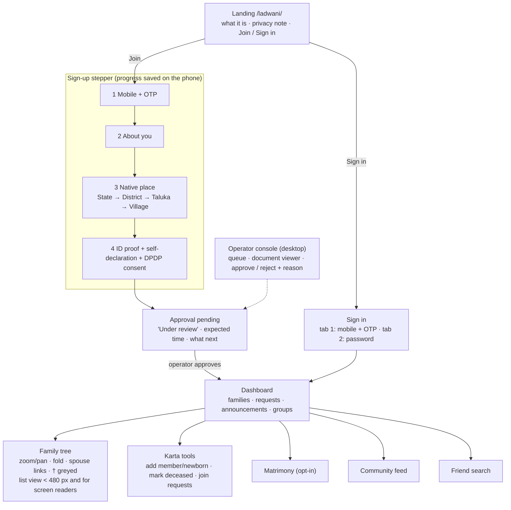
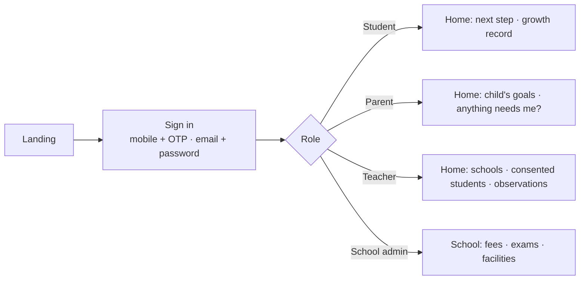
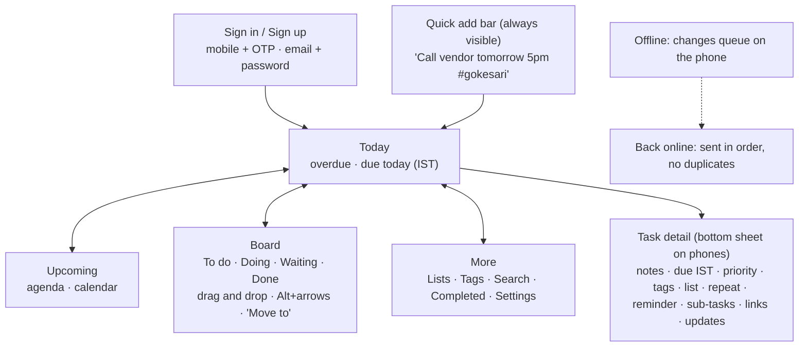

# Information architecture and user flows (Ideate)

## The estate

Each project's header carries the same shell:
- the bkesari logo, which returns to the hub;
- the project name in its accent;
- the All-projects switcher;
- the language and theme controls;
- the account menu of **that project only**.

## Hub

## LadWani

## Education

## TaskList

## Navigation per project

| Project | Phone bottom nav (max 4) | Desktop side nav |
|---|---|---|
| LadWani | Home · Family · Search · Profile | the same, plus Matrimony, Community, Approvals (by role) |
| Education | Home · Schools · Notifications · Profile (by role) | the same, plus role tools |
| TaskList | Today · Upcoming · Board · More | Today, Upcoming, Board, Lists, Tags, Search, Completed, Settings |
| Hub | none: a single page with tiles | none |
